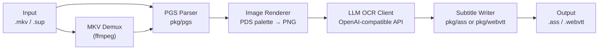

# Linotype — Design Plan

> PGS subtitle → text-based subtitle converter powered by LLM OCR

## Overview

**Linotype** is a Go CLI tool that extracts PGS (Presentation Graphic Stream) bitmap subtitles from MKV files or raw `.sup` files, sends each subtitle image to an OpenAI-compatible vision LLM for OCR, and writes the results as `.ass` (Advanced SubStation Alpha) or `.webvtt` subtitle files with proper positioning, alignment, and color.

---

## Architecture



---

## Decisions Summary

| Decision | Choice |
|---|---|
| **Input formats** | `.mkv` (auto-extract via ffmpeg) and raw `.sup` files |
| **ffmpeg dependency** | Required on PATH (documented prerequisite) |
| **PGS parsing** | Custom pure Go parser in `pkg/pgs/` with clean public API |
| **Output formats** | `.ass` (default) or `.webvtt`, selected via `--format` flag |
| **OCR image format** | PNG (lossless, universal API support) |
| **LLM configuration** | YAML config file (`linotype.yaml`) with CLI flag overrides |
| **Config file search** | CWD → `~/.config/linotype/config.yaml` → `--config` flag |
| **Concurrency** | `--workers N` flag (default 4), parallel OCR with ordered reassembly |
| **Prompt strategy** | Embedded default prompt + `--language` hint; prompt overridable in YAML |
| **Positioning** | Full mapping: PGS window/object coords → ASS `\an`/`\pos` and WebVTT `line`/`position`/`align` |
| **Color preservation** | Extract dominant non-background color from PDS → ASS `\c` / WebVTT CSS |
| **Multi-track handling** | Process ALL PGS tracks, output separate files (`movie.track1.ass`, etc.) |
| **Output location** | Same directory as input file, matching base name |
| **CLI framework** | Standard `flag` package (flat, no subcommands) |
| **YAML library** | `gopkg.in/yaml.v3` |
| **Progress display** | Charmbracelet progress bar with current/total, elapsed, ETA; `--quiet` flag for automation |
| **Logging** | `charmbracelet/log` |
| **Error handling** | Fail fast on API errors (no retry, no skip) |
| **Resume/caching** | Not in v1 |
| **Tests** | Comprehensive: PGS parser, ASS/WebVTT formatters, mock LLM client |

---

## Project Structure

```
linotype/
├── main.go                    # Entry point, flag parsing, orchestration
├── go.mod
├── go.sum
├── linotype.yaml.example      # Example config file
├── pkg/
│   ├── pgs/                   # PGS/SUP binary parser (reusable library)
│   │   ├── parser.go          # Stream reader, segment dispatcher
│   │   ├── segments.go        # PCS, WDS, PDS, ODS, END segment types
│   │   ├── display.go         # DisplaySet assembly (groups segments into displayable units)
│   │   ├── palette.go         # PDS palette → RGBA color mapping
│   │   ├── image.go           # ODS RLE decode → image.RGBA → PNG bytes
│   │   └── parser_test.go     # Tests with fixture data
│   ├── ocr/                   # LLM OCR client
│   │   ├── client.go          # OpenAI-compatible vision API client
│   │   ├── prompt.go          # Default prompt templates + language hint
│   │   └── client_test.go     # Mock HTTP server tests
│   ├── ass/                   # ASS subtitle writer
│   │   ├── writer.go          # ASS file generation with positioning/color
│   │   └── writer_test.go
│   ├── webvtt/                # WebVTT subtitle writer
│   │   ├── writer.go          # WebVTT file generation with cue settings
│   │   └── writer_test.go
│   ├── extract/               # MKV → SUP extraction via ffmpeg
│   │   ├── ffmpeg.go          # ffprobe + ffmpeg subprocess management
│   │   └── ffmpeg_test.go
│   └── config/                # YAML config loading + flag merging
│       ├── config.go          # Config struct, load logic, flag overrides
│       └── config.go_test.go
└── testdata/                  # Test fixtures
    └── sample.sup             # Small PGS file for parser tests
```

---

## PGS Parser Design (`pkg/pgs`)

### Segment Types

| Type | ID | Purpose |
|---|---|---|
| PCS | `0x16` | Presentation Composition — video dimensions, composition state, object references with X/Y |
| WDS | `0x17` | Window Definition — window ID, X/Y position, width/height |
| PDS | `0x14` | Palette Definition — 256-entry YCBCR+Alpha palette |
| ODS | `0x15` | Object Definition — RLE-encoded bitmap data |
| END | `0x80` | End of Display Set marker |

### SUP File Format

Each segment:
```
Bytes 0-1:   "PG" magic (0x50 0x47)
Bytes 2-5:   PTS (presentation timestamp, 90kHz clock)
Bytes 6-9:   DTS (decoding timestamp)
Byte 10:     Segment type
Bytes 11-12: Segment data size (big-endian)
Bytes 13+:   Segment data
```

### Public API

```go
package pgs

// DisplaySet represents a complete subtitle display event
type DisplaySet struct {
    PTS       time.Duration
    DTS       time.Duration
    Width     int           // Video width from PCS
    Height    int           // Video height from PCS
    State     CompositionState
    Windows   []Window
    Palette   Palette
    Objects   []Object
    Compositions []CompositionObject // X/Y positions from PCS
}

// Parse reads a SUP stream and yields DisplaySets
func Parse(r io.Reader) ([]DisplaySet, error)
```

---

## LLM OCR Client (`pkg/ocr`)

### API Contract

Uses the OpenAI Chat Completions API with vision:

```
POST {base_url}/v1/chat/completions
{
  "model": "...",
  "messages": [
    {"role": "system", "content": "<OCR prompt with language hint>"},
    {"role": "user", "content": [
      {"type": "image_url", "image_url": {"url": "data:image/png;base64,..."}}
    ]}
  ],
  "max_tokens": 256
}
```

### Default Prompt

```
You are an OCR engine. The image contains subtitle text in {language}.
Return ONLY the exact text visible in the image, preserving line breaks.
Do not add explanations, translations, or formatting.
```

---

## Output Formats

### ASS Positioning

Map PGS coordinates to ASS override tags:
- **Alignment**: Derive `\an1`–`\an9` from the subtitle's position relative to video dimensions (9-grid)
- **Position**: Use `\pos(x, y)` for pixel-accurate placement
- **Color**: Use `\c&HBBGGRR&` from the dominant palette color

### WebVTT Positioning

Map PGS coordinates to WebVTT cue settings:
- `line:N%` — vertical position as percentage
- `position:N%` — horizontal position as percentage  
- `align:start|center|end` — text alignment

---

## CLI Usage

```
linotype [flags] <input.mkv|input.sup>

Flags:
  --format string      Output format: ass, webvtt (default "ass")
  --workers int        Number of concurrent OCR workers (default 4)
  --language string    Language hint for OCR (default "English")
  --config string      Path to config file
  --quiet              Suppress progress bar (for automation)
```

---

## Config File (`linotype.yaml`)

```yaml
api:
  base_url: "https://api.openai.com"
  api_key: "sk-..."
  model: "gpt-4o"

ocr:
  language: "English"
  prompt: |
    You are an OCR engine. The image contains subtitle text in {language}.
    Return ONLY the exact text visible in the image.

workers: 4
format: "ass"
```

---

## Dependencies

| Package | Purpose |
|---|---|
| `gopkg.in/yaml.v3` | YAML config parsing |
| `github.com/charmbracelet/bubbles/progress` | Progress bar TUI |
| `github.com/charmbracelet/bubbletea` | TUI framework |
| `github.com/charmbracelet/log` | Styled logging |

> [!IMPORTANT]
> **External tool required:** `ffmpeg` and `ffprobe` must be installed and on `PATH` for MKV input support. SUP files work without ffmpeg.
