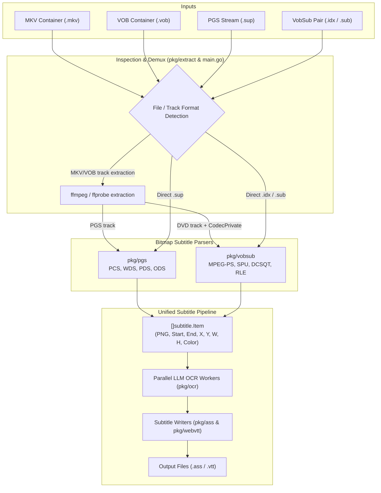

# Linotype — VOBSUB / DVD Subtitle Support Implementation Plan

## Goal Description
Expand Linotype beyond Blu-ray PGS (`.sup`) subtitles to support DVD VOBSUB bitmap subtitles. This enables converting DVD subtitles from `.mkv`, `.vob`, `.idx`, and `.sub` files into `.ass` or `.webvtt` text subtitles with OCR, maintaining pixel-accurate positioning, timing, and color extraction.

A new pure-Go `pkg/vobsub` package will mirror the architecture of `pkg/pgs`, while container inspection and dispatching in `pkg/extract` and `main.go` will automatically detect whether tracks or files are PGS or VOBSUB format.

---

## Architecture Overview



---

## User Review Required

> [!IMPORTANT]
> **Key Decisions Aligned During Interview**:
> 1. **Package Layout**: `pkg/vobsub` is an independent package mirroring `pkg/pgs` (MPEG-PS demuxer, SPU packet parser, DCSQT control sequences, 2-bit RLE decoder, palette mapping, PNG rendering).
> 2. **Format Detection & Dispatch**: Handled at runtime in `main.go` and `pkg/extract`.
> 3. **Input Support**: Accepts `.mkv`, `.vob`, `.sup`, `.idx`, and `.sub`. If `.idx` or `.sub` is supplied, its counterpart in the same directory is automatically loaded.
> 4. **Container Track Handling**: `pkg/extract` discovers all bitmap subtitle tracks (`hdmv_pgs_subtitle` and `dvd_subtitle`), extracting and OCRing each track with track index and language in the output filename.
> 5. **Palette Resolution**: Palette is read from `.idx` or MKV CodecPrivate. If absent (e.g. standalone `.vob` or `.sub` without `.idx`), it falls back to a high-contrast standard DVD subtitle palette (White text, Black border, Grey shadow).
> 6. **Pipeline Unification**: `SubtitleItem` moves to `pkg/subtitle.Item`, used directly across `pkg/pgs` and `pkg/vobsub` without aliasing, allowing `main.go`'s OCR worker pool and writers to be shared with zero duplication.

---

## Open Questions

None. All architectural and operational decisions have been resolved.

---

## Proposed Changes

### Component 1: `pkg/subtitle` (Unified Item Model)

Move `SubtitleItem` from `pkg/pgs` into `pkg/subtitle/item.go` so both `pkg/pgs` and `pkg/vobsub` output the same data structure directly into the OCR pipeline.

#### [NEW] `pkg/subtitle/item.go`
```go
package subtitle

import (
	"image/color"
	"time"
)

// Item represents an extracted subtitle image with timing and geometry,
// ready for OCR processing.
type Item struct {
	Index       int
	StartTime   time.Duration
	EndTime     time.Duration
	PNGData     []byte
	X           int
	Y           int
	Width       int
	Height      int
	VideoWidth  int
	VideoHeight int
	Color       color.RGBA
}
```

---

### Component 2: `pkg/pgs` (Use `subtitle.Item`)

Update `pkg/pgs/items.go` and `pkg/pgs/items_test.go` to use `subtitle.Item` directly instead of defining its own struct.

#### [MODIFY] `pkg/pgs/items.go`
- Remove local `SubtitleItem` declaration.
- Change `ExtractSubtitleItems(sets []DisplaySet) ([]subtitle.Item, error)`.
- Change `buildItem(...) (subtitle.Item, error)`.

#### [MODIFY] `pkg/pgs/items_test.go`
- Update test references to `subtitle.Item`.

---

### Component 3: `pkg/vobsub` (Pure-Go VOBSUB / DVD SPU Parser)

A new package mirroring `pkg/pgs`:

#### [NEW] `pkg/vobsub/palette.go`
- 16-color master palette representation (RGBA).
- Parse `.idx` hex palette lines (`palette: 000000, 7f7f7f, e0e0e0, ...`).
- High-contrast DVD fallback palette when no `.idx` or CodecPrivate is provided.
- Color mapping: maps 2-bit color index (0..3) through `SET_COLOR` nibbles to RGBA.
- Contrast/Alpha mapping: maps 4-bit contrast nibble (0..15) to alpha channel (`alpha = contrast * 17`).

#### [NEW] `pkg/vobsub/spu.go`
- SPU (Subpicture Unit) binary structure:
  - Header: 2-byte total size, 2-byte DCSQT offset.
  - Pixel data: top field (even lines) and bottom field (odd lines) offsets.
  - DCSQT (Display Control Sequence Table):
    - Subpicture timing: start delay, stop command (`STP_DSP`, `0x02`).
    - `0x00` FSTA_DSP / `0x01` STA_DSP: Start display.
    - `0x03` SET_COLOR: 4 color indices (background, pattern, emphasis 1, emphasis 2).
    - `0x04` SET_CONTR: 4 contrast/alpha nibbles.
    - `0x05` SET_DAREA: Bounding box coordinates (`ColStart`, `ColEnd`, `RowStart`, `RowEnd`).
    - `0x06` SET_DSPXA: Top and bottom field pixel offsets.
    - `0xFF` CMD_END: End of control sequence.
- 2-bit interlaced RLE decoder:
  - Decompresses DVD subpicture runs (4-bit, 8-bit, 12-bit, 16-bit, and line-fill codes).
  - Interleaves top-field (even) and bottom-field (odd) lines into full image buffer.

#### [NEW] `pkg/vobsub/idx.go`
- Parser for VobSub `.idx` text file:
  - Video frame size: `size: 720x480`
  - Master palette: `palette: ...`
  - Track language and index: `id: en, index: 0`
  - Timestamp & offset entries: `timestamp: 00:01:23:456, filepos: 000001000`
- Provides track list and cue-points for indexed `.sub` access.

#### [NEW] `pkg/vobsub/parser.go`
- MPEG-2 Program Stream (PS) and PES packet demuxer for `.sub` and `.vob`:
  - Parses Pack headers (`0x000001BA`) and PES packets (`0x000001BD` private_stream_1).
  - Filters by sub-stream ID (`0x20` to `0x3F` for DVD subtitle streams).
  - Extracts PES PTS timestamp.
  - Reassembles fragmented SPU packets across consecutive PES packets into complete SPU payloads.

#### [NEW] `pkg/vobsub/image.go`
- Renders decoded 2-bit pixels + active palette & alpha into `*image.RGBA`.
- Computes dominant text color (ignoring transparent/background pixels).
- Encodes rendered bitmap to PNG bytes.

#### [NEW] `pkg/vobsub/items.go`
- Coordinates SPU parsing, timing, and rendering to produce `[]subtitle.Item`:
  - `ParseStream(subReader io.Reader, palette *Palette, videoW, videoH int) ([]subtitle.Item, error)`
  - `ParseIndexed(idxReader io.Reader, subReader io.ReadSeeker, trackIndex int) ([]subtitle.Item, error)`

#### [NEW] `pkg/vobsub/spu_test.go`, `pkg/vobsub/idx_test.go`, `pkg/vobsub/parser_test.go`
- Synthetic binary fixture tests verifying RLE decompression, control command decoding, `.idx` parsing, and PES demuxing.

---

### Component 4: `pkg/extract` (Multi-Codec Container Extraction)

#### [MODIFY] `pkg/extract/ffmpeg.go`
- Expand `Track` struct:
  ```go
  type SubtitleCodec string

  const (
      CodecPGS    SubtitleCodec = "hdmv_pgs_subtitle"
      CodecVobSub SubtitleCodec = "dvd_subtitle"
  )

  type Track struct {
      Index    int
      RelIndex int
      Language string
      Title    string
      Codec    SubtitleCodec
  }
  ```
- Update `ListSubtitleTracks(ctx context.Context, mediaPath string) ([]Track, error)`:
  - Replaces `ListPGSTracks` (retaining `ListPGSTracks` as a caller if needed).
  - Inspects both `.mkv` and `.vob` containers for `hdmv_pgs_subtitle` and `dvd_subtitle`.
- Add `ExtractDVDSubtitle(ctx context.Context, mediaPath string, trackRelIndex int, outputPath string) error`:
  - Extracts DVD subtitle track from MKV or VOB to a temporary `.vob` / `.sub` stream via `ffmpeg -map 0:s:relIndex -c copy -f vob ...`.
- Add `GetTrackCodecPrivate(ctx context.Context, mediaPath string, trackRelIndex int) ([]byte, error)`:
  - Retrieves CodecPrivate data (containing `.idx` text in MKV) via ffprobe or ffmpeg.

#### [MODIFY] `pkg/extract/ffmpeg_test.go`
- Add tests for mixed PGS and DVD subtitle tracks parsing.

---

### Component 5: `main.go` (Format Dispatch & Unified Processing)

#### [MODIFY] `main.go`
- Update CLI usage and header banner to mention VOBSUB / DVD subtitles:
  - "Linotype — Bitmap Subtitle OCR Converter (PGS & VOBSUB)"
  - Accepted inputs: `.mkv`, `.vob`, `.sup`, `.idx`, `.sub`.
- File routing logic:
  - `.mkv` & `.vob`: inspect tracks with `extract.ListSubtitleTracks`. For each track:
    - If PGS: extract to `.sup` -> `pgs.Parse` -> `pgs.ExtractSubtitleItems` -> `processSubtitleItems`.
    - If VobSub: extract stream + CodecPrivate/palette -> `vobsub.Parse...` -> `processSubtitleItems`.
  - `.sup`: `pgs.Parse` -> `pgs.ExtractSubtitleItems` -> `processSubtitleItems`.
  - `.idx`: parse `.idx`, find companion `.sub` file, iterate tracks in `.idx` -> `vobsub.ParseIndexed` -> `processSubtitleItems`.
  - `.sub`: check if companion `.idx` exists. If yes, delegate to `.idx` parser; if no, parse as standalone `.sub` with default palette -> `processSubtitleItems`.
- Refactor `processSUP`:
  - Rename to `processSubtitleItems(ctx, items []subtitle.Item, outPath, cfg, ocrClient, prompt, quiet, logger, targetDim)`.
  - This function remains 100% agnostic to whether the items originated from PGS or VobSub.

---

## Verification Plan

### Automated Tests
1. **Unit tests for `pkg/subtitle`**: Verify `Item` struct integration.
2. **Unit tests for `pkg/vobsub`**:
   - `idx_test.go`: Parse sample `.idx` metadata, palette hex parsing, track indexing.
   - `spu_test.go`: Decode synthetic SPU byte stream, verify RLE 2-bit expansion, verify bounding box and PTS timing.
   - `parser_test.go`: Parse simulated MPEG-PS PES packets, verify reassembly of split SPU payloads.
3. **Unit tests for `pkg/extract`**:
   - Test JSON unmarshaling of ffprobe output containing `dvd_subtitle` and `hdmv_pgs_subtitle`.
4. **Unit tests for `pkg/pgs`**:
   - Existing PGS tests continue to pass with `subtitle.Item`.
5. **Full suite run**:
   ```pwsh
   go test -v ./...
   ```

### Manual Verification
1. Test CLI `--help` output reflects new supported extensions (`.mkv`, `.vob`, `.sup`, `.idx`, `.sub`).
2. Run linotype on existing `.sup` sample to ensure no regressions in PGS pipeline.
3. Run linotype on a standalone `.idx`/`.sub` fixture or `.vob` test sample with `--quiet` or standard progress bar.
